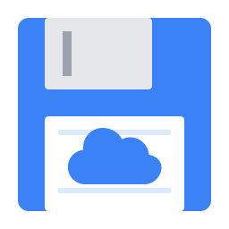

<div align="center">
  
  <h1>CloudGameSaver</h1>
  <p><b>드롭박스(Dropbox) 기반의 세이브 데이터 양방향 자동 동기화 도구</b></p>

  <p>
    
    
    
    
  </p>
</div>

---

> **Note**
> CloudGameSaver는 Windows, macOS, Linux, Android 기기 사이의 세이브 파일을 Dropbox로 양방향 동기화합니다. 파일의 Dropbox Content Hash와 수정 시간을 비교해 변경된 파일을 전송합니다. Android에서는 사용자가 선택한 공유 세이브 폴더를 지원하며, 동기화가 끝날 때까지 앱 화면을 열어두어야 합니다.

## 💻 지원 운영체제

| OS | 배포판 | 상태 |
|:---:|:---:|:---|
| **Windows** | 설치 프로그램 / Portable (.exe) | 설치·자동 업데이트 또는 무설치 실행 |
| **macOS** | Universal App | ARM64/x86_64 유니버설 바이너리 |
| **Linux** | AppImage | 스팀덱(Steam Deck) 최적화 지원 |
| **Android** | APK (ARM64) | Android 7.0 이상, 공유 세이브 폴더 동기화 |

## 🛠 주요 사용 기술 및 라이브러리

| 구성 요소 | 기술 / 라이브러리 | 역할 |
|:---:|:---:|:---|
| **Core** | Tauri v2 | 데스크톱·Android 앱 프레임워크 |
| **Async** | Tokio, Futures | 고성능 비동기 파일 및 병렬 처리 |
| **Network** | Reqwest | Dropbox API 통신 |
| **Security** | Sha2, Hex | Dropbox Content Hash 무결성 검증 |
| **Updater** | Tauri Plugin Updater | 데스크톱 자동 업데이트 확인 및 설치 |
| **Frontend** | React 19, Vite | 모던한 반응형 UI 구성 |
| **CI/CD** | GitHub Actions | 자동화된 멀티플랫폼 빌드 및 배포 |

## 🔄 자동 업데이트 시스템

Windows, macOS, Linux에서는 앱 내 자동 업데이트를 지원합니다. Android는 릴리즈의 새 APK를 설치해 업데이트합니다.

- **자동 감지**: 앱 시작 시 및 30분마다 최신 버전 자동 확인
- **원클릭 업데이트**: 새 버전 발견 시 사용자 확인 후 자동 다운로드/설치  
- **안전한 업데이트**: 디지털 서명 검증을 통한 보안성 보장
- **백그라운드 처리**: 업데이트 중에도 기존 작업 방해 없음

## 📖 개발 가이드

### 환경 구축
- [Rust](https://www.rust-lang.org/) 및 [Node.js](https://nodejs.org/) (LTS) 설치 필수
- **macOS 사용자**: 터미널에서 `curl --proto '=https' --tlsv1.2 -sSf https://sh.rustup.rs | sh` 명령어로 Rust를 설치한 뒤 `source $HOME/.cargo/env`를 실행하세요.
- **환경 변수 설정**: Dropbox 계정 연결을 사용하려면 프로젝트 루트에 `.env` 파일을 생성하세요. 데스크톱은 아래 두 값을 사용하고 Android는 `APP_KEY`만 사용합니다.
  ```text
  APP_KEY=your_dropbox_app_key
  APP_SECRET=your_dropbox_app_secret
  ```

### 빌드 및 실행
```bash
# 의존성 설치
npm ci

# 앱 빌드 및 실행 (개발 모드)
npm run tauri dev

# 프로덕션 빌드 (Windows/Mac/Linux 자동 감지)
npm run tauri build
```

### Android 빌드 및 사용

Android는 시스템 폴더 선택창에서 사용자가 지정한 세이브 폴더에만 접근합니다. 선택한 폴더의 읽기·쓰기 권한은 앱을 재실행해도 유지됩니다. 에뮬레이터의 세이브 위치를 `Documents/GameSaves` 같은 공유 폴더로 지정하고, CloudGameSaver에서 같은 폴더를 연결하세요. 다른 앱의 내부 저장소나 Android 11 이상의 `Android/data`, `Android/obb`에는 접근할 수 없습니다.

Dropbox 앱 키를 프로젝트 루트의 `.env`에 설정하세요. Android는 PKCE 인증을 사용하므로 `APP_SECRET`이 필요하지 않습니다.

```text
APP_KEY=your_dropbox_app_key
```

```bash
npm ci

# macOS/Linux: rustup, Android Rust 타겟, SDK 명령행 도구 및 NDK 설치
# Android Studio 또는 JDK 17/21이 먼저 설치되어 있어야 합니다.
npm run android:setup

# 기기에 설치할 수 있는 개발용 ARM64 APK
npm run android:build -- --debug --ci

# 최적화된 APK에 서명 적용 (artifacts/android에 생성)
# .android-signing/release.env가 있으면 배포키, 없으면 개발용 키 사용
npm run android:package

# 연결된 기기 또는 에뮬레이터에서 개발
npm run android:dev
```

Android 프로젝트는 `src-tauri/gen/android`에 포함되어 있으므로 일반적으로 다시 생성할 필요가 없습니다. 재생성 시 `npm run android:init -- --ci --skip-targets-install`을 사용하고, `app/build.gradle.kts`의 `../../../android` 소스 디렉토리 및 커스텀 ProGuard 규칙을 유지해야 합니다. `ANDROID_HOME`, `NDK_HOME`, `JAVA_HOME`으로 설치 경로를 지정할 수 있습니다. macOS에서는 설치된 Homebrew JDK 21을 우선 사용합니다.

Android 앱 아이콘은 `src-tauri/icons/android`에서 관리하며 빌드·실행 시 Android 프로젝트 리소스에 자동으로 복사됩니다. 일반·원형 아이콘과 Android 8 이상의 적응형 아이콘이 같은 프로젝트 로고를 사용합니다.

APK는 `src-tauri/gen/android/app/build/outputs/apk/` 아래에 생성됩니다. `npm run android:build -- --ci`는 릴리스 APK를 빌드하며, 배포 전 Android 서명 키를 별도로 구성해야 합니다. GitHub Actions의 **Android APK** 워크플로는 개발용 APK를 아티팩트로 생성합니다. CI에서 로그인 가능한 APK를 만들려면 기존 `APP_KEY` 저장소 시크릿을 설정하세요.

태그 릴리즈의 **Auto Release & Update** 워크플로는 배포용 키로 서명한 `CloudGameSaver-android-arm64.apk`를 데스크톱 파일과 같은 GitHub Release 초안에 첨부합니다. `package.json` 버전과 일치하는 `v*` 태그를 푸시하거나 워크플로를 수동 실행하세요. APK 첨부까지 성공한 뒤 데스크톱용 `latest.json`을 생성합니다.

GitHub 저장소의 Actions secrets에 다음 값을 등록해야 합니다. 로컬 `.env`는 CI에 전달되지 않습니다.

| 시크릿 | 값 |
|:---|:---|
| `APP_KEY` | Dropbox 앱 키 (기존 데스크톱 빌드와 공유) |
| `ANDROID_KEYSTORE_BASE64` | 고정 배포용 keystore 파일을 Base64로 인코딩한 값 |
| `ANDROID_KEYSTORE_PASSWORD` | keystore 비밀번호 |
| `ANDROID_KEY_ALIAS` | 배포키 별칭 (`cloudgamesaver`) |
| `ANDROID_KEY_PASSWORD` | 배포키 비밀번호 |

배포키를 처음 구성할 때는 다음 명령을 사용합니다. 기존 배포키가 있으면 같은 키를 계속 사용해야 APK를 덮어쓰기 설치할 수 있습니다.

```bash
mkdir -p .android-signing
keytool -genkeypair -keystore .android-signing/cloudgamesaver-release.jks \
  -alias cloudgamesaver -keyalg RSA -keysize 4096 -validity 10000
base64 < .android-signing/cloudgamesaver-release.jks | gh secret set ANDROID_KEYSTORE_BASE64
gh secret set ANDROID_KEYSTORE_PASSWORD
gh secret set ANDROID_KEY_ALIAS --body cloudgamesaver
gh secret set ANDROID_KEY_PASSWORD
```

로컬에서 배포키를 사용하려면 `.android-signing/release.env`에 `export ANDROID_KEYSTORE_PATH=...`, `export ANDROID_KEY_ALIAS=...`, `export ANDROID_KEYSTORE_PASSWORD=...`, `export ANDROID_KEY_PASSWORD=...`를 설정하거나 같은 환경 변수를 전달하세요. `.android-signing/`은 Git에서 제외되므로 keystore와 비밀번호를 별도로 백업해야 합니다. 앞서 개발용 키로 서명한 APK가 설치되어 있다면 처음 배포용 APK를 설치할 때 기존 앱을 삭제해야 합니다.

앱에서 **Dropbox 계정 연결**을 누른 뒤 브라우저에서 승인을 완료하고 표시된 인증 코드를 앱에 입력합니다. 이후 게임별 세이브 폴더를 연결하고 전체 게임 동기화를 실행하세요. 동기화가 끝날 때까지 앱 화면을 열어두어야 합니다. Android 업데이트는 새 APK 설치 또는 앱스토어 배포를 통해 진행합니다.

네이티브 저장소 테스트는 실제 선택 폴더에서 중첩 경로, 바이너리 무결성, 덮어쓰기 시 파일 크기 축소, `.DS_Store` 제외 및 상위 폴더 접근 거부를 확인합니다. 개발용 APK를 설치하고 `adb shell mkdir -p /sdcard/Documents/CloudGameSaverTest`로 테스트 폴더를 만든 뒤, 앱의 폴더 선택창에서 해당 폴더를 선택하고 `npm run android:test`를 실행하세요. 테스트가 만든 하위 폴더는 종료 시 삭제합니다. 기기가 여러 개 연결되어 있다면 `ANDROID_SERIAL`을 지정하세요.

### 릴리스 배포

릴리즈 워크플로는 `v*` 태그 푸시 또는 수동 실행으로 시작합니다. 태그 이름은 `package.json` 버전과 일치해야 하며, 일반 `main` 푸시는 릴리즈를 생성하지 않습니다. 버전을 변경할 때는 npm 잠금 파일, Rust 패키지·잠금 파일, Tauri 설정의 버전·창 제목, `src/App.tsx`의 버전 배지도 함께 갱신하세요.

```bash
# package.json, src-tauri/tauri.conf.json, src-tauri/Cargo.toml을 같은 버전으로 변경
# 아래는 v0.2.2 릴리스 예시
git add .
git commit -m "Release v0.2.2"
git tag -a v0.2.2 -m "Release v0.2.2"
git push origin main
git push origin v0.2.2

# 자동으로 다음 작업들이 수행됩니다:
# 1. 멀티플랫폼 빌드 (Windows/macOS/Linux/Android ARM64)
# 2. 디지털 서명 적용
# 3. GitHub Release 초안 생성 및 APK 첨부
# 4. 자동 업데이트 매니페스트(latest.json) 생성
# 초안을 확인한 뒤 GitHub에서 릴리스 게시
```

## 🔧 프로젝트 구조

```
cloudgamesaver/
├── src/                    # React 프론트엔드
├── src-tauri/              # Rust 백엔드 및 네이티브 프로젝트
│   ├── src/                # 동기화 로직과 플랫폼별 저장소 접근
│   ├── android/            # Android 공유 폴더 접근 플러그인
│   ├── gen/android/        # Android Gradle 프로젝트
│   ├── icons/              # 데스크톱·모바일 앱 아이콘
│   ├── tauri.conf.json     # 공통 Tauri 설정
│   └── tauri.android.conf.json # Android 설정
├── scripts/                # Android 도구 설치·빌드·서명·테스트
├── .github/workflows/     # GitHub Actions CI/CD
└── dist/                  # 빌드 출력 (자동 생성)
```

## 📄 라이선스

이 프로젝트는 **MIT License**를 따릅니다. 상세 내용은 [LICENSE](LICENSE) 파일을 참조해 주세요.

## 📥 다운로드 및 설치

### 최신 버전 다운로드
[](https://github.com/garoad/cloudgamesaver/releases/latest)

| 운영체제 | 다운로드 링크 | 파일 형식 |
|:---:|:---:|:---:|
| **Windows** | [CloudGameSaver.exe](https://github.com/garoad/cloudgamesaver/releases/latest/download/CloudGameSaver.exe) / [CloudGameSaver-portable.exe](https://github.com/garoad/cloudgamesaver/releases/latest/download/CloudGameSaver-portable.exe) | 설치 프로그램 / 무설치 실행파일 |
| **macOS** | [CloudGameSaver.app](https://github.com/garoad/cloudgamesaver/releases/latest) | Universal App |
| **Linux** | [CloudGameSaver.AppImage](https://github.com/garoad/cloudgamesaver/releases/latest) | AppImage |
| **Android** | [CloudGameSaver-android-arm64.apk](https://github.com/garoad/cloudgamesaver/releases/latest/download/CloudGameSaver-android-arm64.apk) | ARM64 APK (Android 7.0 이상) |

### 사용법

1. **앱 실행** → 운영체제에 맞는 릴리즈 파일을 설치하거나 실행합니다.
2. **Dropbox 연결** → 계정 연결 버튼을 누르고 브라우저에서 승인합니다. Android는 브라우저에 표시된 인증 코드를 앱에 입력합니다.
3. **게임 추가** → 게임별 로컬 세이브 폴더와 Dropbox 폴더를 지정합니다. Android는 시스템 폴더 선택창에서 공유 폴더를 선택합니다.
4. **동기화 시작** → 사용할 게임을 활성화하고 전체 게임 동기화를 실행합니다. Android는 완료될 때까지 앱을 열어두세요.

> **Tip**: 데스크톱은 앱에서 자동 업데이트를 확인합니다. Android는 같은 배포키로 서명된 새 APK를 설치하면 기존 설정을 유지하며 업데이트할 수 있습니다.

---

## 🚀 v0.2.2 주요 개선 사항 (Latest)

* **Android 지원**: 공유 세이브 폴더 선택 및 권한 유지, Dropbox PKCE 인증, 모바일 화면 레이아웃을 추가했습니다.
* **Android APK 릴리즈**: 버전 태그 릴리즈에 고정 배포키로 서명한 ARM64 APK를 자동 첨부합니다.
* **Android 앱 아이콘 수정**: Tauri 기본 아이콘 대신 프로젝트의 구름·디스켓 아이콘을 사용하며 원형·적응형 아이콘을 지원합니다.
* **동기화 오류 처리 개선**: 파일 읽기 및 HTTP 요청 실패를 동기화 결과에 반영하고, 다운로드 응답을 확인한 뒤 세이브 파일을 덮어씁니다.

0.2.2 APK는 ARM64 릴리즈 빌드, 서명 및 16KB 정렬 검증을 통과했습니다. Retroid Pocket Classic(Android 14)에 업데이트 설치해 버전 표시와 런처 아이콘을 확인했습니다. Android 네이티브 저장소 테스트는 중첩 폴더·바이너리 읽기/쓰기·덮어쓰기·경로 검증을, Rust 단위 테스트는 선택 폴더 밖으로 나가는 경로와 데스크톱에서의 Android URI 사용을 거부하는지 검증합니다.

## 🚀 v0.2.1 주요 개선 사항

* **Windows 자동 업데이트 서명 오류 해결**: GitHub Actions 릴리스 배포 시 NSIS 인스톨러(`CloudGameSaver.exe`)와 포터블 바이너리(`CloudGameSaver-portable.exe`)의 파일명을 분리하여, 서명 해시 불일치로 인해 Windows 환경에서 자동 업데이트가 실패하던 문제를 수정했습니다.
* **게임 관리 목록 UI 스크롤 사용성 개선**: 우측 메인 영역의 '새 게임 추가' 섹션과 '게임 관리 목록'이 중첩 스크롤되지 않고 메인 영역에서 함께 스크롤되도록 레이아웃을 개선하여 작은 화면에서도 목록을 더 편리하게 볼 수 있도록 개선했습니다.

## 🚀 v0.2.0 주요 개선 사항

* **16:9 Split 레이아웃 UI 전면 개편**: 좌측 고정 패널(설정, 빠른 동기화 버튼, 로그 창)과 우측 독립 스크롤 게임 관리 리스트 구조로 대화면 모니터에 최적화하였습니다.
* **토큰 갱신 시 상태창 유지 & 로딩 이탈 방지**: 토큰이 만료되어 자동으로 갱신(Refresh)되는 동안 동기화 진행 상태창(로딩 모달)이 닫히지 않고 지속적으로 유지되며 실시간 진행 상황을 표시하도록 개선했습니다.
* **상세 실행 풀 로그(Full Log) 보기**: 좌측 상태창에 "📋 전체 로그 보기" 버튼을 추가하여 파일 비교, 업로드/다운로드, 동일 파일 생략 등 모든 동기화 내역을 타임스탬프와 함께 상세히 확인할 수 있습니다.
* **게임 관리 모달 및 드롭박스 클라우드 폴더 삭제 기능**: 각 게임 카드에 [✏️ 편집] 모달과 [🗑️ 삭제] 모달을 추가하였으며, 삭제 시 드롭박스 클라우드의 폴더도 함께 지울 수 있도록 연동했습니다.
* **OS 시스템 전용 파일 제외 (.DS_Store)**: 동기화 비교 및 업로드/다운로드 스캔 시 macOS의 `.DS_Store` 파일이 자동으로 스킵되도록 필터링을 구현했습니다.

## 🚀 v0.1.9 주요 개선 사항

* **토큰 자동 갱신**: 목록 갱신 시 토큰이 만료되어도 자동으로 refresh token으로 새 토큰을 발급받아 작업을 재개합니다. 더 이상 토큰 만료로 인한 재로그인이 필요하지 않습니다.
* **향상된 세션 관리**: 토큰 갱신 후 새 토큰이 자동으로 저장되고 UI에 즉시 반영됩니다.

## 🚀 v0.1.8 주요 개선 사항

*   **macOS 네트워크 연결 문제 해결**: `reqwest`의 TLS 백엔드를 `rustls`로 변경하여 macOS에서 발생하던 드롭박스 API 연결 오류(Request Error)를 완전히 해결했습니다.
*   **클라우드 경로 정규화**: 사용자가 입력한 클라우드 경로에 슬래시(/) 유무에 관계없이 드롭박스 API 표준인 절대 경로 형식으로 자동 변환하여 동기화 안정성을 높였습니다.
*   **빌드 시스템 안정화**: `.env` 파일의 환경 변수가 빌드 시점에 앱에 올바르게 포함되도록 `build.rs`를 개선하고, macOS에서의 Rust 설치 가이드를 추가했습니다.
*   **에러 로깅 강화**: 동기화 중 발생하는 네트워크 및 파싱 에러를 더 상세하게 출력하여 문제 진단이 용이하도록 개선했습니다.

## 🚀 v0.1.7 주요 개선 사항

*   **자동 폴더 생성**: 클라우드에 게임 폴더가 존재하지 않을 때 자동으로 폴더를 생성하여 신규 게임 추가 시 발생하던 "path_not_found" 에러를 완전히 해결했습니다.
*   **로딩 UX 개선**: 동기화 완료 시 이벤트 기반 처리로 로딩창이 정확한 시점에 닫히도록 수정하여 사용자 경험을 크게 개선했습니다.
*   **즉시 취소 응답**: 동기화 취소 버튼 클릭 시 즉시 로딩창이 종료되고 상태가 초기화되도록 반응성을 향상시켰습니다.
*   **향상된 에러 처리**: path_not_found와 토큰 만료 에러를 더욱 정확하게 구분하여 처리하고 적절한 복구 로직을 적용합니다.

## 🚀 v0.1.5 주요 개선 사항

*   **완전 자동화된 업데이트 시스템**: GitHub Actions와 연동된 자동 빌드/배포 시스템으로 새 버전이 출시되면 앱 내에서 자동으로 감지하고 원클릭 업데이트가 가능합니다.
*   **Portable 실행파일 제공**: 설치 과정 없이 다운로드 즉시 실행 가능한 단일 실행파일로 배포 방식을 변경했습니다.
*   **최적화된 UI/UX**: 업데이트 확인 버튼을 적절한 위치에 배치하고 버튼 겹침 현상을 완전히 해결했습니다.
*   **멀티플랫폼 CI/CD**: GitHub Actions를 통한 Windows/macOS/Linux 동시 빌드 및 자동 릴리스 생성으로 개발 효율성을 크게 향상시켰습니다.
*   **스마트 에러 복구**: 네트워크 오류 발생 시 자동 재시도 로직(최대 3회)과 정기적인 업데이트 확인(30분 간격)을 추가했습니다.
*   **향상된 사용자 피드백**: 업데이트 진행 상황을 실시간으로 표시하고 다운로드 크기, 진행률을 명확하게 제공합니다.

## 🚀 v0.1.4 주요 개선 사항

*   **영구 세션 유지 (Refresh Token)**: 4시간마다 만료되던 기존의 단기 액세스 토큰 방식을 탈피하여 리프레시 토큰 시스템을 도입했습니다. 이제 한 번의 로그인으로 세션이 반영구적으로 유지됩니다.
*   **지능형 양방향 동기화 강화**: 로컬과 클라우드 파일의 해시뿐만 아니라 수정 시간을 정밀하게 비교하여 단 1ms의 차이도 감지하고 최신 파일을 선택합니다.
*   **Dropbox 표준 해시 검증**: 4MB 블록 단위 SHA256 스트리밍 해시 계산을 통해 파일 내용이 실제로 다른지 완벽하게 검증합니다.
*   **실시간 동기화 피드백**: 동기화 진행 상황을 실시간 진행바(ProgressBar)와 현재 처리 중인 파일명을 통해 시각적으로 전달합니다.
*   **안정적인 네트워크 복구**: 동기화 중 토큰 만료(401)가 발생해도 자동으로 토큰을 갱신하고 작업을 즉시 재개합니다.

<div align="center">
  <p>© 2026 CloudGameSaver Project. All rights reserved.</p>
</div>
